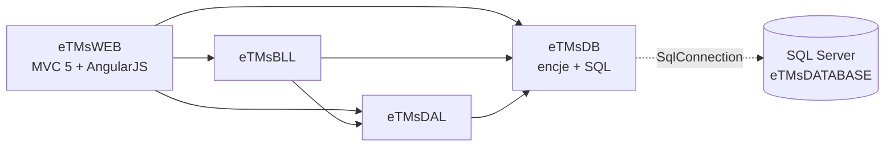

# Struktura — co realnie zależy od czego

## TL;DR

- Klasyczne warstwy **WEB → BLL → DAL → DB**, ale BLL jest prawie pusty, a cała logika danych siedzi w **jednym pliku SQL-w-stringach**: `eTMsDB/REPOSITORIES/AppDbContext.cs` (3876 linii). `evidence`
- Główne centra: `AppDbContext.cs` / `IAppDbContext.cs` (fan-out 37/36), `eTMsDAL/MODELS/Result.cs` (fan-in 25), encja `PozyczkaLombardowa.cs` (fan-in 16). `evidence`
- Jeden kontroler + jeden DAL `PozyczkaLombardowa*` obsługują 5 capability (pożyczki, kasa, książka lombardowa, sprzedaż zastawów, remanent). `evidence`
- Jeden 10-węzłowy cykl — zamyka się przez god-context i rejestrację DI, nie przez pętle feature↔feature. `evidence` + `inference`

## Rozpoznanie narzędzi (przed wyborem grafu)

| Sprawdzone | Wynik |
| --- | --- |
| Package manager | NuGet przez `packages.config` (4 projekty), paczki wcommitowane w `packages/` |
| Skrypty buildu | tylko `clean.bat` (kasuje `bin/` i `obj/`); brak CI, `Directory.Build.*`, `global.json`, `nuget.config`, `.editorconfig` |
| Workspace | `eTMsLomb.sln`: eTMsWEB, eTMsBLL, eTMsDAL, eTMsDB (.NET Framework 4.5.2) + `eTMsDATABASE.sqlproj` (SSDT) |
| Aliasy ścieżek | n/d (C#: namespace'y; JS bez bundlera/modułów) |
| Istniejące narzędzie do grafu | brak |
| Toolchain | `dotnet` 10.0.401 jest, ale `dotnet list eTMsWEB.csproj reference` **pada** — brak `Microsoft.WebApplication.targets` (stary projekt Web, wymaga Visual Studio/MSBuild) |
| Narzędzia dedykowane (NDepend, dotnet-deptree) | nie zainstalowane — **niczego nie instalowano** |

Wybór: referencje projektów z `*.csproj` (poziom projektów) + własny ekstraktor referencji po nazwach typów dla `.cs`/`.cshtml` (poziom plików) → `.work/edges-csharp.csv` (140 plików, 86 typów, 351 krawędzi) → `graph-metrics.mjs` z mapowaniem na capability.

## Graf projektów (evidence: `ProjectReference`)

WEB omija BLL i woła DAL bezpośrednio (`unitOfWorkDAL` w kontrolerach). `evidence`

## Entry pointy

| Entry point | Rola | Grubość |
| --- | --- | --- |
| `eTMsWEB/Global.asax.cs`, `App_Start/RouteConfig.cs`, `App_Start/FilterConfig.cs`, `ETMSWEBConfigure.cs` | start aplikacji, routing, globalne filtry, rejestracja Autofac | cienkie (wiring) |
| `eTMsWEB/Filters/CheckSessionAttribute.cs` | globalny filtr na **każdym** żądaniu: ładuje użytkownika, placówkę, uprawnienia → sesja; tworzy `new AppDbContext()` z pominięciem DI | średnie, krytyczne |
| `eTMsWEB/Controllers/PozyczkaLombardowaController.cs` (802 l.) | ~50 akcji: cykl życia pożyczki, kasa, książka, sprzedaż, remanent | gruby wejściowo, deleguje do DAL |
| `eTMsWEB/Controllers/AdminController.cs` (375 l.) | użytkownicy, uprawnienia, placówki, parametry, typy zastawów, **konsola SQL** `DBWykonaj` | średni |
| `HomeController.cs`, `KlientController.cs`, `SzablonController.cs` | logowanie, klienci, szablony | cienkie |
| `eTMsWEB/Scripts/<Obszar>/*.js` | AngularJS, woła kontrolery przez stringi URL | graf: `unknown` |

## Lokalne centra (głębokie moduły)

| Plik | Linie | Fan-in | Fan-out | Dlaczego centrum |
| --- | --: | --: | --: | --- |
| `eTMsDB/REPOSITORIES/AppDbContext.cs` | 3876 | — | 37 | **całe SQL systemu**; 921 linii z `" +`, 390 z konkatenacją wartości w cudzysłowach; transakcje tylko jako `BEGIN/COMMIT TRAN` w stringach (32 linie) |
| `eTMsDB/INTERFACES/IAppDbContext.cs` | — | 12 | 36 | kontrakt DB dla wszystkich DAL |
| `eTMsDAL/REPOSITORY/PozyczkaLombardowaDAL.cs` | 3166 | — | 25 | orkiestracja przepływów pieniężnych 5 capability |
| `eTMsDAL/MODELS/Result.cs` | — | 25 | — | koperta wyniku `Result<T>` używana wszędzie — kontrakt między warstwami |
| `eTMsDB/ENTITIES/PozyczkaLombardowa.cs` | — | 16 | — | encja rdzenia domeny |
| `eTMsBLL/REPOSITORY/PozyczkaLombardowaBLL.cs` | 139 | — | — | jedyna logika biznesowa poza SQL: `Wylicz`, `WyliczRRSO` (odsetki, RRSO) |

Cienkie: `ETMSCoreBLL`, `UnitOfWorkBLL` (delegacja, serializacja JSON).

## Kontrakty między warstwami

- `IAppDbContext` (DB → DAL) — jeden interfejs na cały system. `evidence`
- `IUnitOfWorkDAL` / `IUnitOfWorkBLL` (DAL/BLL → WEB) — agregat wszystkich DAL. `evidence`
- `Result<T>` (każda warstwa → WEB → JSON do AngularJS). `evidence`
- Kontrakt WEB ↔ JS: nazwy akcji w URL + kształt JSON — nieweryfikowany przez build. `inference`
- Kontrakt C# ↔ schemat SQL: kolumny w stringach SQL vs DDL w `eTMsDATABASE` — nieweryfikowany przez build. `inference`

## Graf capability (z `graph-metrics.mjs`)

| Capability | Ca | Ce | Instability |
| --- | --: | --: | --: |
| shared (DB context, DAL plumbing, layout) | 9 | 10 | 0.53 |
| pawn-loans | 5 | 8 | 0.62 |
| branches | 4 | 1 | 0.20 |
| templates | 3 | 1 | 0.25 |
| users-access | 1 | 4 | 0.80 |
| cashdesk / collateral-sale / stocktake | 2 | 2 | 0.50 |
| clients / parameters | 2 | 1 | 0.33 |
| collateral-types | 2 | 0 | 0 (liść) |
| pawn-ledger | 0 | 2 | 1 (wejście) |

## Cykle i podejrzane zależności

- **Cykl 10 węzłów** (wszystko poza pawn-ledger i collateral-types): zamyka się przez `shared` — `AppDbContext`/`IAppDbContext`/`UnitOfWorkDAL`/`AutofacModuleDAL`/`AutoMapperDAL` znają encje i DAL każdego obszaru, a każdy DAL zna `IAppDbContext`. Najmniejsza realna pętla: `PozyczkaLombardowaDAL.cs → IAppDbContext.cs → ENTITIES/PozyczkaLombardowa*.cs`. Część krawędzi (~30) to rejestracja DI — mechaniczne (config-as-code).
- **pawn-loans ⇄ cashdesk**: `PozyczkaLombardowaItem.cs → PozyczkaLombardowaKasaOperacjaItem.cs` oraz `PozyczkaLombardowaKasaIndex.cshtml → PozyczkaLombardowa.cs`.
- **WEB → DB z pominięciem DI**: `CheckSessionAttribute` tworzy `new AppDbContext()`.
- **WEB → surowe SQL**: `AdminController.DBWykonaj` → `AppDbContext.GetDataSet(query)` z treści żądania.
- **Uprawnienia tylko w UI** (`inference`, do weryfikacji): brak `[Authorize]`/sprawdzeń ról w kontrolerach; role czytane wyłącznie w `_MyMenu.cshtml`/`_MySubMenu.cshtml`. Anonimowi są blokowani przez `<deny users="?"/>` w `Web.config`.

## Blast radius — co pęknie przy zmianie

| Zmieniasz | Kto zależy | Ryzyko |
| --- | --- | --- |
| `AppDbContext.cs` | **wszystkie 12 capability** | regresja w dowolnym obszarze; brak testów; format dat/locale (precedens: 375c6fd) |
| `IAppDbContext.cs`, `Result.cs` | wszystkie DAL, kontrolery, JS (kształt JSON) | łamie kontrakt z frontem bez błędu kompilacji po stronie JS |
| `PozyczkaLombardowaDAL.cs` / `Controller` | pożyczki, kasa, książka, sprzedaż, remanent | przepływy pieniężne i raporty regulacyjne |
| `PozyczkaLombardowaBLL.cs` | wyliczenia odsetek/RRSO w pożyczkach | błędne kwoty — jedyne miejsce testowalne jednostkowo |
| `CheckSessionAttribute.cs` | każde żądanie | logowanie, placówka, uprawnienia |
| encja + DDL + SQL | ręcznie trzymane trio | dryf bez sygnału z buildu |

## Ryzyka testowe

Brak projektu testowego i plików testów. Logika w stringach SQL → sensowne są tylko testy integracyjne na SQL Server; `Wylicz`/`WyliczRRSO` nadają się do testów jednostkowych.

## Unknowns

- Sprzężenia przez tabele w JOIN-ach SQL (kasa ↔ pożyczki) — SQL nie parsowany.
- JS ↔ endpointy (stringi URL) — bez grafu.
- DI/Autofac, AutoMapper, refleksja, typy przez `var` — poza zasięgiem ekstraktora.
- Integracja Allegro (`PozyczkaLombardowaZastawParametrAllegro`) — `unknown (external)`.
- Warte rozważenia: analizator oparty o Roslyn albo NDepend (nie instalowano).

## Komendy

`grep ProjectReference */*.csproj`, `dotnet --version`, `dotnet list eTMsWEB/eTMsWEB.csproj reference` (błąd), `node scratchpad/edges.mjs` (ekstrakcja referencji typów), `node .claude/skills/10x-repo-map/scripts/graph-metrics.mjs .work/edges-csharp.csv --modules .work/capabilities.tsv --kind runtime [--emit mermaid]`, `awk` (krawędzie między capability), `git grep -c` (wzorce konkatenacji SQL, `BEGIN TRAN`, `[Authorize]`, `zalogowanyRole`), `wc -l`.
