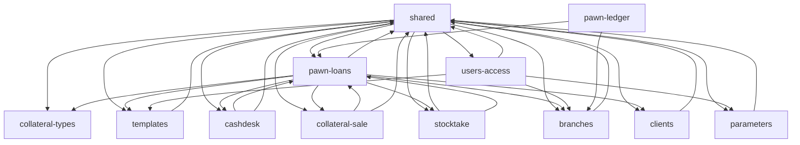

# Evidence: structure

## Graph sources

| Language | Source | Level | Confidence | Blind spots |
| --- | --- | --- | --- | --- |
| C# + Razor (140 files) | type-name references: a file → the file declaring a type it names (`.work/edges-csharp.csv`, 351 edges, 86 declared types) | 4 (fallback) | low–medium | same-named types, `var`-inferred types, Autofac DI registration, reflection, AutoMapper maps; `dotnet list reference` gives only project level (WEB→BLL,DAL,DB; BLL→DAL,DB; DAL→DB) |
| SQL (eTMsDATABASE) | none | — | unknown | raw SQL strings in C# are not parsed; DDL has no FKs analysed |
| JS (AngularJS, own scripts) | none | — | unknown | JS→controller coupling is via URL strings (`'Admin/DBWykonaj'`), not imports |

## Capability graph

Runtime edges, capability level (`graph-metrics.mjs --modules capabilities.tsv --kind runtime`):

| Node | Ca | Ce | Instability |
| --- | --: | --: | --: |
| shared | 9 | 10 | 0.53 |
| pawn-loans | 5 | 8 | 0.62 |
| branches | 4 | 1 | 0.20 |
| users-access | 1 | 4 | 0.80 |
| templates | 3 | 1 | 0.25 |
| cashdesk | 2 | 2 | 0.50 |
| collateral-sale | 2 | 2 | 0.50 |
| stocktake | 2 | 2 | 0.50 |
| clients | 2 | 1 | 0.33 |
| parameters | 2 | 1 | 0.33 |
| collateral-types | 2 | 0 | 0 |
| pawn-ledger | 0 | 2 | 1 |

(Emitted by graph-metrics.mjs; copy in `.work/graph-caps.mmd`.)

## Blast radius per capability

- **shared** — `eTMsDB/REPOSITORIES/AppDbContext.cs` (fan-out 37, 3876 lines) and `eTMsDB/INTERFACES/IAppDbContext.cs` (fan-out 36) hold the SQL of **all** capabilities; `eTMsDAL/MODELS/Result.cs` has fan-in 25 (result envelope used everywhere). Any change here reaches every capability. evidence.
- **pawn-loans** — one controller (`PozyczkaLombardowaController.cs`, 802 lines), one DAL (`PozyczkaLombardowaDAL.cs`, 3166 lines), one DAL interface and one BLL (`PozyczkaLombardowaBLL.cs`, 139 lines: `Wylicz`, `WyliczRRSO`) serve pawn-loans **and** cashdesk, pawn-ledger, collateral-sale, stocktake. Those four have entities, views and scripts but no own controller/DAL. Entity `PozyczkaLombardowa.cs` fan-in 16. evidence.
- **cashdesk / collateral-sale / stocktake / pawn-ledger** — depend on pawn-loans entity and its monolith files; change radius = the monolith. evidence.
- **users-access** — `eTMsWEB/Filters/CheckSessionAttribute.cs` (global filter) depends on users and branches DALs; runs on every request. evidence.
- **clients** — consumed by pawn-loans (loan parties view). evidence.

## Cycles

One 10-node strongly connected component; it closes through **shared**: `AppDbContext`/`IAppDbContext`/`UnitOfWorkDAL`/`AutofacModuleDAL`/`AutoMapperDAL` reference every capability's entities and DALs, while every DAL references `IAppDbContext`. Smallest real loop: `eTMsDAL/REPOSITORY/PozyczkaLombardowaDAL.cs → eTMsDB/INTERFACES/IAppDbContext.cs → eTMsDB/ENTITIES/PozyczkaLombardowa*.cs` — i.e. the god-context pattern, not a feature-to-feature loop. Feature-level: pawn-loans ⇄ cashdesk (`PozyczkaLombardowaItem.cs → PozyczkaLombardowaKasaOperacjaItem.cs`; `PozyczkaLombardowaKasaIndex.cshtml → PozyczkaLombardowa.cs`). evidence.

## Broken boundaries

Intended layering (inference from project references): DB (entities+SQL) → DAL → BLL → WEB.
- BLL is almost empty (3 files, ~255 lines); controllers call DAL directly via `unitOfWorkDAL` (e.g. `AdminController.DBWykonaj` → `unitOfWorkDAL.AppDbContext.GetDataSet(query)`). Business rules likely live in SQL strings and controllers — inference.
- WEB reaches into DB layer (`AppDbContext`) from `CheckSessionAttribute` (`new AppDbContext()`), bypassing DI. evidence.
- Folder ≠ capability: one controller/DAL file serves five capabilities; `AdminController` serves users-access, branches, parameters, templates, collateral-types and the DB console. evidence.

## Test risks

No test project and no test files (`git ls-files | grep -i test` → none). Logic sits in raw SQL concatenated in C# (`AppDbContext.cs`: 921 lines containing `" +`, 390 with quote-concatenation) → only integration tests against a real SQL Server are meaningful; `Wylicz`/`WyliczRRSO` in `PozyczkaLombardowaBLL.cs` are the one unit-testable piece. inference.

## Centres and thin entry points

- Load-bearing centres: `AppDbContext.cs`, `IAppDbContext.cs`, `Result.cs`, entity `PozyczkaLombardowa.cs`.
- Thin layer: BLL (`ETMSCoreBLL`, `UnitOfWorkBLL`) — mostly delegation/JSON serialisation.

## Mechanical signals

- Edges from `AutofacModuleDAL.cs`, `AutofacModuleBLL.cs`, `ETMSWEBConfigure.cs`, `UnitOfWorkDAL.cs` (≈30 edges): DI registration and unit-of-work wiring — config-as-code fan-out (rule 2). They inflate the shared cycle.
- `_MyMenu.cshtml`/`_MySubMenu.cshtml` → users-access entities: menu rendering.

## Unknowns

- Runtime coupling through SQL: tables shared between capabilities in queries (e.g. kasa ↔ pożyczki joins) are invisible to the type graph; a SQL parse of `AppDbContext.cs` would show it.
- JS ↔ controller endpoints (URL strings) not graphed.
- `PozyczkaLombardowaZastawParametrAllegro` (controller line 95) — possible external integration (Allegro marketplace) — `unknown (external)`.
- Stored procedures/triggers: none in `eTMsDATABASE` (only tables) — logic is in C# strings; transactions only as `BEGIN/COMMIT TRAN` in those strings (32 lines in AppDbContext.cs). evidence.
- Tool worth installing: NDepend or Roslyn-based analyzer for a real C# graph (not installed).

Commands: `grep ProjectReference */*.csproj`, `node scratchpad/edges.mjs` (type-reference extraction), `node graph-metrics.mjs --modules capabilities.tsv --kind runtime [--emit mermaid]`, `awk` cross-edge listing, `git grep -c` over SQL-concatenation patterns, `wc -l`.
