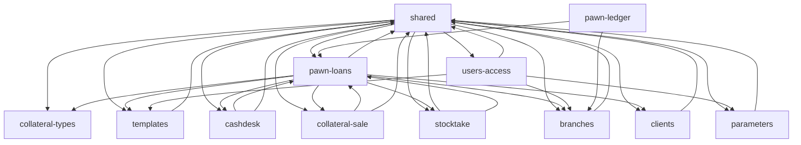

# Repo map — eTMsLomb (pawnshop management system)

**Working artifacts (sources of this map):**
- [artifact-1-territory.md](artifact-1-territory.md): change history, active areas, co-change, noise filter
- [artifact-2-structure.md](artifact-2-structure.md): dependencies, entry points, cycles, local centres, blast radius
- [artifact-3-contributors.md](artifact-3-contributors.md): contributor context for the data access layer (`AppDbContext.cs`)

## TL;DR

eTMsLomb is a back-office web app for a **pawnshop (lombard)**. It is ASP.NET MVC 5 on .NET 4.5.2 with AngularJS views and SQL Server. Staff use it to register **pawn loans** with collateral (create, sign, pay out, repay in part or in full, top up, extend, sell the collateral). It also covers the branch **cash desk** and its settlements, the regulatory **pawn ledger** (*książka lombardowa*), **collateral sales**, **stocktake** (*remanent*), **clients** (KYC data with history), and admin of **users and permissions**, **branches**, **parameters** and **print templates**. There is **no buzz to rank**. The code arrived as one import in May 2020, and since then exactly one source change landed: a `set dateformat ymd` fix across all SQL in Feb 2022. The repo has been dormant for ~32 months. It has no PRs, reverts, plans or TODOs, and git is the only source. So this map ranks by **criticality and reach**. Where it hurts is structural. All SQL of every capability is built by string concatenation in one 3.9k-line file. One 3.2k-line DAL and one 800-line controller carry five money-handling capabilities. There are no tests. Permission checks appear to happen only in the menu (needs verification).

*(Capability graph from the structure evidence. `shared` is the DB context, DAL plumbing and layout.)*

## Terrain

Buzz families: change · fix · friction · attention · reach. Change, fix, friction and attention are **zero for every business capability** (history: 0 post-import commits; discussion: no PRs, plans or markers). Only *reach* differs.

| Capability | What it does | Criticality (criteria) | Reach | Trend | Where it lives |
| --- | --- | --- | --- | --- | --- |
| **pawn-loans** | Loan lifecycle: create, metrics, parties, authorised persons, notes, collateral, actions (sign, pay out, withdraw, cancel, partial/full repayment, top-up, transfer, accept, copy), interest and APR (`Wylicz`, `WyliczRRSO`), printouts | high (money, user data, core value) | high (Ca 5 / Ce 8; hosts 4 other capabilities) | dormant | `eTMsWEB/Controllers/PozyczkaLombardowaController.cs`, `eTMsDAL/REPOSITORY/PozyczkaLombardowaDAL.cs`, `eTMsBLL/REPOSITORY/PozyczkaLombardowaBLL.cs`, `Views/` + `Scripts/PozyczkaLombardowa/`, `TB_POZYCZKI_LOMBARDOWE*` |
| **cashdesk** | Branch cash desk: cash operations, settlements, daily printouts (synthetic, settlements) | high (money) | medium | dormant | `*PozyczkaLombardowaKasa*` views/JS/entities, `TB_POZYCZKI_LOMBARDOWE_KASA*`; logic inside the pawn-loans controller and DAL |
| **collateral-sale** | Selling forfeited collateral, CSV export, sale printout; possible Allegro parameters | high (money, possible external integration) | medium | dormant | `*OperacjaSprzedazy*` views/JS/entities; logic inside the pawn-loans files |
| **pawn-ledger** | Regulatory pawn register (*książka lombardowa*): list, entry, printout | medium (core value/compliance, read-only) | low (entry, Ca 0) | dormant | `*KsiazkaLombardowa*` views/JS |
| **stocktake** | Collateral inventory reports, analytic and synthetic | medium (core value, read-only) | low | dormant | `*Remanent*` views/JS/entities |
| **clients** | Client records with history, document types, employment | high (personal data) | medium | dormant | `eTMsWEB/Controllers/KlientController.cs`, `eTMsDAL/REPOSITORY/KlientDAL.cs`, `TB_KLIENCI*` |
| **users-access** | Login/logout, users, password reset, permissions per branch and module, session filter | high (identity and access) | medium (global filter on every request) | dormant | `eTMsWEB/Controllers/HomeController.cs`, `AdminController.cs`, `eTMsWEB/Filters/CheckSessionAttribute.cs`, `UzytkownikDAL.cs`, `UzytkownikUprawnienieDAL.cs`, `TB_UZYTKOWNICY*`, `SL_UPRAWNIENIA`, `SL_MODULY` |
| **branches** | Branches (*placówki*) with history; which users may access which branch | medium (access scoping) | medium (Ca 4) | dormant | `eTMsDAL/REPOSITORY/PlacowkaDAL.cs`, `Views/Admin/PlacowkaIndex.cshtml`, `TB_PLACOWKI*` |
| **parameters** | System parameters (rates and limits likely; inference) | medium (feeds the money calculations; inference) | low | dormant | `ParametrDAL.cs`, `TB_PARAMETRY`, `SL_PARAMETRY` |
| **templates** | Print templates for contracts and printouts | medium (legal documents) | low–medium (Ca 3) | dormant | `SzablonController.cs`, `SzablonDAL.cs`, `TB_SZABLONY` |
| **collateral-types** | Dictionary of collateral types | low | low (leaf) | dormant | `*ZastawTyp*` |
| **db-console** | Admin page that runs **arbitrary SQL** and returns a DataSet; query log | high (exposure: raw DB access from the web) | low | dormant | `AdminController.DBWykonaj`, `Views/Admin/DBIndex.cshtml`, `Scripts/Admin/DBIndex.js`, `TB_QUERY_LOG` |

- **Shared foundations** (53 files, 24%): `eTMsDB/REPOSITORIES/AppDbContext.cs` holds **all SQL of the system**. Also `AppDbContextBase.cs` (SqlConnection/SqlCommand), `IAppDbContext.cs`, `eTMsDAL/MODELS/Result.cs` (fan-in 25), the UnitOfWork, Autofac and AutoMapper wiring, layout and menus.
- **Platform** (20 files, 9%): `eTMsLomb.sln`, csproj files, `Web.config` plus per-site copies (`Web.config.SUKURS`, `PLIKI/Web.config`), publish profile `LOKAL`, SSDT project `eTMsDATABASE` (DDL only, `CreateDB.sql`, `Initial.sql`), `clean.bat`. NuGet `packages/` is committed (vendored, excluded).
- **Docs**: README is a title only. `context/` is scaffold only.
- Coverage: 221 code files, unmapped 0. Shared plus platform is 33% of files, below the 40% limit. The share of *changes* is not meaningful (1 source change).

**Folder ≠ capability.** One controller, DAL, DAL interface and BLL (`PozyczkaLombardowa*`) serve five capabilities: pawn-loans, cashdesk, ledger, sale and stocktake. One `AdminController` serves users, branches, parameters, templates, collateral types and the DB console. All capabilities share one SQL file.

## Real couplings

| Coupling | How we know | Mechanical? |
| --- | --- | --- |
| Every capability → `AppDbContext.cs` / `IAppDbContext.cs` (god context, raw SQL) | runtime graph (fan-out 37/36); the only source fix touched 110 queries of many capabilities at once | no — hand-kept |
| pawn-loans ⇄ cashdesk, and pawn-loans → collateral-sale, stocktake | runtime graph (`PozyczkaLombardowaItem.cs → PozyczkaLombardowaKasaOperacjaItem.cs`; Kasa/Sale/Remanent views → `PozyczkaLombardowa.cs`); shared monolith files | no |
| pawn-loans → clients, branches, templates, collateral-types | runtime graph (loan parties view, branch on entity, print templates) | no |
| users-access → branches, parameters, templates | runtime graph (`CheckSessionAttribute` → `PlacowkaDAL`; `AdminController`) | no |
| Shared cycle across 10 capabilities | runtime graph; closes through DI/UoW registration and the god context | partly (Autofac/UoW wiring is config-as-code) |
| C# entities ↔ SQL DDL (`eTMsDATABASE`) ↔ SQL strings ↔ AngularJS models | **unknown**: no SQL or JS graph, no co-change history | — hand-kept, unguarded (no build check ties them) |
| Tables shared inside SQL joins (cash ↔ loans) | **unknown**: SQL not parsed | — |
| Allegro (`PozyczkaLombardowaZastawParametrAllegro`) | action name only | `unknown (external)` |

## Risk zones

**No capability qualifies by the criticality × buzz rule.** Buzz is zero in four of five families for every capability, because the repository has no history after the import. The items below are **watch** items, built from criticality, reach and static hazards found by commands. They are not built from buzz. Treat them as the starting points for a focused investigation before any larger change.

**Watch 1 — Shared data access (`AppDbContext.cs`): SQL by string concatenation.** All 12 capabilities depend on it. 921 lines contain `" +` and 390 concatenate quoted values, e.g. `where klientId = " + klientId`. There are no C# transactions (`BeginTransaction`/`TransactionScope`: 0); transactions exist only as `BEGIN/COMMIT TRAN` inside SQL strings (32 lines). Its only post-import change was a cross-cutting date-format fix in 110 queries, which shows how locale-sensitive the queries are. Signals: reach (structure: fan-out 37, all capabilities), the history fix (history: 375c6fd). These are independent but anecdotal. Files: `eTMsDB/REPOSITORIES/AppDbContext.cs`, `eTMsDB/REPOSITORIES/AppDbContextBase.cs`.

**Watch 2 — pawn-loans monolith carrying the money flows.** Loan actions, cash desk, collateral sale, ledger and stocktake share `PozyczkaLombardowaDAL.cs` (3166 lines) and `PozyczkaLombardowaController.cs` (802 lines). Interest and APR live in `PozyczkaLombardowaBLL.cs`. There are no tests anywhere. Signals: criticality high (money, core value), reach high (Ca 5 / Ce 8, hosts 4 capabilities). Files: the three above, plus `eTMsWEB/Scripts/PozyczkaLombardowa/PozyczkaLombardowa.js` (1392 lines).

**Watch 3 — users-access and db-console: permissions likely enforced only in the UI.** These are inferences and need verification. Anonymous users are denied globally (`<deny users="?"/>` in `eTMsWEB/Web.config`). Roles are computed into the session by `CheckSessionAttribute`. However, `git grep` finds no `[Authorize]` or role check in any controller; roles are read only in `_MyMenu.cshtml` and `_MySubMenu.cshtml`. If that holds, any logged-in user can call admin actions. That includes `AdminController.DBWykonaj`, which runs arbitrary SQL from the request body. `customErrors mode="Off"` is set in the project `Web.config`. Credential markers (`password=`/`pwd=`) appear in 4 committed config files. Signals: criticality high (access, exposure), static evidence from structure and configs.

**Looks hot, is not**
- `eTMsDATABASE/*.jfm`, `*.dbmdl`, `*.csproj.user`, `*.pubxml.user` in the last commit: IDE state, mechanical.
- The 10-node cycle: mostly DI/UnitOfWork wiring and the god-context pattern, not feature-to-feature loops.
- "0 TODOs": this is not low debt. Markers are simply absent.
- `packages/`, vendored jQuery/Angular/Bootstrap, fonts and images: 186 of 407 tracked files, excluded as noise.

## Whom to ask

Team baseline: 1–2 identities in the whole history, so concentration is the norm.

| Zone | Person | Why |
| --- | --- | --- |
| Watch 1 (SQL / data access) | Tomasz Mularczyk | Authored the only post-import source change (date format across all queries) |
| Watch 2, 3 and everything else | tomsoft1 | Imported the whole code base; possibly the original author, possibly the same person as above (unknown) |

## First day

1. `eTMsLomb.sln` and `eTMsWEB/Web.config`: projects, auth mode, connection setup.
2. `eTMsWEB/Filters/CheckSessionAttribute.cs` and `eTMsWEB/App_Start/FilterConfig.cs`: how login, branch and permissions reach the session.
3. `eTMsWEB/Controllers/PozyczkaLombardowaController.cs`: the entry point for five capabilities. Read the action list first.
4. `eTMsBLL/REPOSITORY/PozyczkaLombardowaBLL.cs`: interest and APR calculation, the only real business logic outside SQL.
5. `eTMsDAL/REPOSITORY/PozyczkaLombardowaDAL.cs`: where the loan, cash and sale flows are orchestrated.
6. `eTMsDB/REPOSITORIES/AppDbContext.cs` (with `AppDbContextBase.cs`): every query of the system.
7. `eTMsDATABASE/scripts/CreateDB.sql`: the data model in one file (28 tables, `TB_` data and `SL_` dictionaries).
8. `eTMsWEB/Controllers/AdminController.cs`: admin areas and the `DBWykonaj` SQL console.

## Limitations

- **Window**: the requested 12 months had 0 commits. The whole history was used: 4 commits, of which 1 is the 407-file initial import (excluded) and 2 are README edits. History, trend, fix pressure, co-change and people statistics are anecdotal. Development before 2020-05-06, or elsewhere, is invisible.
- **Sources**: git only. `gh` is not installed, so PRs, issues and reviews on the GitHub remote were not read.
- **Graph coverage**: for C#/Razor, a type-name reference fallback (level 4). It misses DI/Autofac resolution, AutoMapper, reflection, `var`-inferred and same-named types. For SQL and AngularJS JS there is no graph (`unknown`): couplings through table joins and URL-string endpoints are not mapped. A Roslyn-based tool or NDepend (not installed) would raise C# confidence.
- **Capability coverage**: unmapped 0%, shared 24% and platform 9% of code files. Cashdesk, collateral-sale, stocktake and ledger are attributed by file name only. Their logic sits inside the pawn-loans files, so pawn-loans is overstated and they are understated.
- **Agents**: the four evidence briefs ran sequentially in the main agent instead of as parallel sub-agents, given 4 commits of history. Nothing failed.
- **What this map does NOT say**: whether the system runs in production, at which sites, against which DB version. It also does not say whether the permission gap (Watch 3) is real: no code path was traced end to end. Nothing was verified against the running app.
- **Unknowns worth a focused investigation**:
  - server-side authorization of admin and money actions, and of `DBWykonaj`;
  - SQL injection surface in `AppDbContext.cs`;
  - transactional integrity of cash operations: transactions live only in SQL text (32 `BEGIN/COMMIT TRAN` lines), so check which multi-step flows they actually cover;
  - the Allegro integration;
  - drift between entities, DDL and SQL strings;
  - secrets in committed configs;
  - whether tomsoft1 and Tomasz Mularczyk are the same person;
  - whether development continues in another repository.
