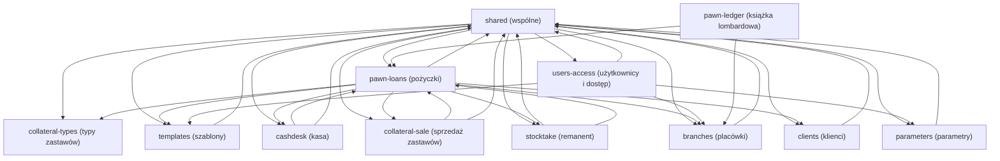

# Mapa projektu — eTMsLomb (system obsługi lombardu)

**Artefakty robocze (źródła tej mapy):**
- [artifact-1-territory.md](artifact-1-territory.md): historia zmian, aktywne obszary, co-change, filtr szumu
- [artifact-2-structure.md](artifact-2-structure.md): zależności, entry pointy, cykle, lokalne centra, blast radius
- [artifact-3-contributors.md](artifact-3-contributors.md): kontekst kontrybutorów dla warstwy danych (`AppDbContext.cs`)

Identyfikatory capability (`pawn-loans`, `cashdesk`…) celowo zostały po angielsku. Są takie same jak w `.work/capabilities.tsv` i w plikach evidence.

## TL;DR

eTMsLomb to aplikacja back-office dla **lombardu**: ASP.NET MVC 5 na .NET 4.5.2, widoki AngularJS, SQL Server. Pracownicy rejestrują w niej **pożyczki lombardowe** z zastawami (utworzenie, podpisanie, wypłata, spłata częściowa i całkowita, dopożyczenie, przedłużenie, sprzedaż zastawu). System obejmuje też **kasę** placówki z rozliczeniami, regulacyjną **książkę lombardową**, **sprzedaż zastawów**, **remanent**, **klientów** (dane KYC z historią) oraz administrację **użytkownikami i uprawnieniami**, **placówkami**, **parametrami** i **szablonami wydruków**.

**Nie ma „buzzu” do rankingu.** Kod trafił do repo jednym importem w maju 2020. Od tego czasu weszła dokładnie jedna zmiana w kodzie: poprawka `set dateformat ymd` we wszystkich zapytaniach SQL (luty 2022). Repo jest uśpione od ~32 miesięcy. Nie ma PR-ów, revertów, planów ani TODO, a jedynym źródłem jest git. Dlatego ta mapa szereguje obszary według **krytyczności i zasięgu**.

Boli struktura:
- całe SQL wszystkich capability jest sklejane ze stringów w jednym pliku liczącym 3,9 tys. linii;
- jeden DAL (3,2 tys. linii) i jeden kontroler (800 linii) obsługują pięć capability, przez które płyną pieniądze;
- nie ma testów;
- uprawnienia wydają się sprawdzane tylko w menu (do weryfikacji).

*(Graf capability z evidence strukturalnego. Krawędzie bez zmian, przetłumaczone są tylko etykiety. `shared` to kontekst DB, warstwa DAL i layout.)*

## Teren

Rodziny sygnałów buzz: zmiany · poprawki · tarcie · uwaga · zasięg. Zmiany, poprawki, tarcie i uwaga są **zerowe dla każdej capability biznesowej**: w historii nie ma żadnego commita po imporcie, a w dyskusji nie ma PR-ów, planów ani markerów. Różni się tylko *zasięg*.

| Capability | Co robi | Krytyczność (kryteria) | Zasięg | Trend | Gdzie żyje |
| --- | --- | --- | --- | --- | --- |
| **pawn-loans** (pożyczki) | Cykl życia pożyczki: utworzenie, metryka, strony, upoważnieni, uwagi, zastawy, akcje (podpisz, wypłać, wycofaj, rezygnuj, spłata częściowa/całkowita, dopożyczenie, przenieś, przyjmij, kopiuj), odsetki i RRSO (`Wylicz`, `WyliczRRSO`), wydruki | wysoka (pieniądze, dane klientów, rdzeń wartości) | wysoki (Ca 5 / Ce 8; mieści 4 inne capability) | uśpiony | `eTMsWEB/Controllers/PozyczkaLombardowaController.cs`, `eTMsDAL/REPOSITORY/PozyczkaLombardowaDAL.cs`, `eTMsBLL/REPOSITORY/PozyczkaLombardowaBLL.cs`, `Views/` + `Scripts/PozyczkaLombardowa/`, `TB_POZYCZKI_LOMBARDOWE*` |
| **cashdesk** (kasa) | Kasa placówki: operacje kasowe, rozliczenia, wydruki dzienne (syntetyka, rozliczenia) | wysoka (pieniądze) | średni | uśpiony | widoki/JS/encje `*PozyczkaLombardowaKasa*`, `TB_POZYCZKI_LOMBARDOWE_KASA*`; logika w kontrolerze i DAL pożyczek |
| **collateral-sale** (sprzedaż zastawów) | Sprzedaż przepadłych zastawów, eksport CSV, wydruk sprzedaży; możliwe parametry Allegro | wysoka (pieniądze, możliwa integracja zewnętrzna) | średni | uśpiony | widoki/JS/encje `*OperacjaSprzedazy*`; logika w plikach pożyczek |
| **pawn-ledger** (książka lombardowa) | Regulacyjny rejestr lombardowy: lista, pozycja, wydruk | średnia (rdzeń/zgodność z przepisami, tylko odczyt) | niski (wejście, Ca 0) | uśpiony | widoki/JS `*KsiazkaLombardowa*` |
| **stocktake** (remanent) | Raporty inwentaryzacji zastawów, analityka i syntetyka | średnia (rdzeń, tylko odczyt) | niski | uśpiony | widoki/JS/encje `*Remanent*` |
| **clients** (klienci) | Kartoteka klientów z historią, typy dokumentów, zatrudnienie | wysoka (dane osobowe) | średni | uśpiony | `eTMsWEB/Controllers/KlientController.cs`, `eTMsDAL/REPOSITORY/KlientDAL.cs`, `TB_KLIENCI*` |
| **users-access** (użytkownicy i dostęp) | Logowanie/wylogowanie, użytkownicy, reset hasła, uprawnienia per placówka i moduł, filtr sesji | wysoka (tożsamość i dostęp) | średni (globalny filtr na każdym żądaniu) | uśpiony | `eTMsWEB/Controllers/HomeController.cs`, `AdminController.cs`, `eTMsWEB/Filters/CheckSessionAttribute.cs`, `UzytkownikDAL.cs`, `UzytkownikUprawnienieDAL.cs`, `TB_UZYTKOWNICY*`, `SL_UPRAWNIENIA`, `SL_MODULY` |
| **branches** (placówki) | Placówki z historią; którzy użytkownicy mają dostęp do której placówki | średnia (zakres dostępu) | średni (Ca 4) | uśpiony | `eTMsDAL/REPOSITORY/PlacowkaDAL.cs`, `Views/Admin/PlacowkaIndex.cshtml`, `TB_PLACOWKI*` |
| **parameters** (parametry) | Parametry systemu (prawdopodobnie stawki i limity; inference) | średnia (zasila wyliczenia kwot; inference) | niski | uśpiony | `ParametrDAL.cs`, `TB_PARAMETRY`, `SL_PARAMETRY` |
| **templates** (szablony) | Szablony wydruków umów i dokumentów | średnia (dokumenty prawne) | niski–średni (Ca 3) | uśpiony | `SzablonController.cs`, `SzablonDAL.cs`, `TB_SZABLONY` |
| **collateral-types** (typy zastawów) | Słownik typów zastawów | niska | niski (liść) | uśpiony | `*ZastawTyp*` |
| **db-console** (konsola SQL) | Strona admina, która wykonuje **dowolne SQL** i zwraca DataSet; log zapytań | wysoka (ekspozycja: surowy dostęp do bazy z poziomu WWW) | niski | uśpiony | `AdminController.DBWykonaj`, `Views/Admin/DBIndex.cshtml`, `Scripts/Admin/DBIndex.js`, `TB_QUERY_LOG` |

- **Wspólne fundamenty** (53 pliki, 24%): `eTMsDB/REPOSITORIES/AppDbContext.cs` zawiera **całe SQL systemu**. Do tego `AppDbContextBase.cs` (SqlConnection/SqlCommand), `IAppDbContext.cs`, `eTMsDAL/MODELS/Result.cs` (fan-in 25), okablowanie UnitOfWork, Autofac i AutoMapper, layout i menu.
- **Platforma** (20 plików, 9%): `eTMsLomb.sln`, pliki csproj, `Web.config` z kopiami per wdrożenie (`Web.config.SUKURS`, `PLIKI/Web.config`), profil publikacji `LOKAL`, projekt SSDT `eTMsDATABASE` (tylko DDL, `CreateDB.sql`, `Initial.sql`), `clean.bat`. Paczki NuGet w `packages/` są wcommitowane (vendored, wykluczone).
- **Dokumentacja**: README to sam tytuł. `context/` zawiera tylko szkielet.
- Pokrycie: 221 plików kodu, niezmapowanych 0. Wspólne plus platforma to 33% plików, poniżej progu 40%. Udział w *zmianach* nie ma znaczenia (1 zmiana w kodzie).

**Folder ≠ capability.** Jeden kontroler, DAL, interfejs DAL i BLL (`PozyczkaLombardowa*`) obsługują pięć capability: pożyczki, kasę, książkę, sprzedaż i remanent. Jeden `AdminController` obsługuje użytkowników, placówki, parametry, szablony, typy zastawów i konsolę SQL. Wszystkie capability dzielą jeden plik SQL.

## Realne powiązania

| Powiązanie | Skąd wiemy | Mechaniczne? |
| --- | --- | --- |
| Każda capability → `AppDbContext.cs` / `IAppDbContext.cs` (god context, surowe SQL) | graf runtime (fan-out 37/36); jedyna poprawka w kodzie dotknęła naraz 110 zapytań wielu capability | nie, utrzymywane ręcznie |
| pawn-loans ⇄ cashdesk oraz pawn-loans → collateral-sale, stocktake | graf runtime (`PozyczkaLombardowaItem.cs → PozyczkaLombardowaKasaOperacjaItem.cs`; widoki Kasa/Sprzedaż/Remanent → `PozyczkaLombardowa.cs`); wspólne pliki-monolity | nie |
| pawn-loans → clients, branches, templates, collateral-types | graf runtime (widok stron pożyczki, placówka na encji, szablony wydruków) | nie |
| users-access → branches, parameters, templates | graf runtime (`CheckSessionAttribute` → `PlacowkaDAL`; `AdminController`) | nie |
| Wspólny cykl przez 10 capability | graf runtime; zamyka się przez rejestrację DI/UoW i god context | częściowo (okablowanie Autofac/UoW to config-as-code) |
| Encje C# ↔ DDL SQL (`eTMsDATABASE`) ↔ stringi SQL ↔ modele AngularJS | **unknown**: brak grafu SQL i JS, brak historii co-change | trzymane ręcznie, niechronione (build ich nie wiąże) |
| Tabele współdzielone w JOIN-ach SQL (kasa ↔ pożyczki) | **unknown**: SQL nie był parsowany | — |
| Allegro (`PozyczkaLombardowaZastawParametrAllegro`) | tylko nazwa akcji | `unknown (external)` |

## Strefy ryzyka

**Żadna capability nie spełnia reguły krytyczność × buzz.** Buzz jest zerowy w czterech z pięciu rodzin dla każdej capability, bo repo nie ma historii po imporcie. Poniżej są pozycje **watch** (do obserwacji). Wynikają z krytyczności, zasięgu i statycznych zagrożeń znalezionych komendami, a nie z buzzu. Traktuj je jako punkty startowe pogłębionej analizy przed każdą większą zmianą.

**Watch 1 — Wspólna warstwa danych (`AppDbContext.cs`): SQL sklejane ze stringów.**
- Zależą od niej wszystkie 12 capability.
- 921 linii zawiera `" +`, a 390 dokleja wartości w cudzysłowach, np. `where klientId = " + klientId`.
- W C# nie ma transakcji (`BeginTransaction`/`TransactionScope`: 0). Transakcje istnieją tylko jako `BEGIN/COMMIT TRAN` w stringach SQL (32 linie).
- Jedyna zmiana po imporcie to przekrojowa poprawka formatu dat w 110 zapytaniach. Pokazuje, jak bardzo zapytania zależą od ustawień regionalnych.
- Sygnały: zasięg (struktura: fan-out 37, wszystkie capability) i poprawka w historii (375c6fd). Są niezależne, ale anegdotyczne.
- Pliki: `eTMsDB/REPOSITORIES/AppDbContext.cs`, `eTMsDB/REPOSITORIES/AppDbContextBase.cs`.

**Watch 2 — Monolit pożyczek, przez który płyną pieniądze.**
- Akcje pożyczek, kasa, sprzedaż zastawów, książka i remanent dzielą `PozyczkaLombardowaDAL.cs` (3166 linii) i `PozyczkaLombardowaController.cs` (802 linie).
- Odsetki i RRSO są w `PozyczkaLombardowaBLL.cs`.
- Nigdzie nie ma testów.
- Sygnały: wysoka krytyczność (pieniądze, rdzeń wartości), wysoki zasięg (Ca 5 / Ce 8, mieści 4 capability).
- Pliki: trzy powyższe oraz `eTMsWEB/Scripts/PozyczkaLombardowa/PozyczkaLombardowa.js` (1392 linie).

**Watch 3 — users-access i db-console: uprawnienia prawdopodobnie egzekwowane tylko w UI.** To wnioski (inference) do weryfikacji.
- Anonimowi użytkownicy są blokowani globalnie (`<deny users="?"/>` w `eTMsWEB/Web.config`).
- `CheckSessionAttribute` wylicza role i zapisuje je w sesji.
- `git grep` nie znajduje jednak `[Authorize]` ani sprawdzenia ról w żadnym kontrolerze. Role są czytane tylko w `_MyMenu.cshtml` i `_MySubMenu.cshtml`.
- Jeśli to się potwierdzi, każdy zalogowany użytkownik może wywołać akcje admina. Dotyczy to też `AdminController.DBWykonaj`, które wykonuje dowolne SQL z treści żądania.
- W projektowym `Web.config` jest `customErrors mode="Off"`.
- Ślady haseł (`password=`/`pwd=`) są w 4 wcommitowanych plikach konfiguracyjnych.
- Sygnały: wysoka krytyczność (dostęp, ekspozycja), statyczne dowody ze struktury i konfiguracji.

**Wygląda na gorące, ale nie jest**
- `eTMsDATABASE/*.jfm`, `*.dbmdl`, `*.csproj.user`, `*.pubxml.user` w ostatnim commicie: stan IDE, mechaniczne.
- Cykl przez 10 węzłów: głównie okablowanie DI/UnitOfWork i wzorzec god context, a nie pętle między funkcjonalnościami.
- „0 TODO” nie oznacza małego długu. Po prostu nikt nie używał takich markerów.
- `packages/`, vendored jQuery/Angular/Bootstrap, fonty i obrazy: 186 z 407 śledzonych plików, wykluczone jako szum.

## Kogo zapytać

Baseline zespołu: 1–2 tożsamości w całej historii, więc skupienie wiedzy jest tu normą.

| Strefa | Osoba | Dlaczego |
| --- | --- | --- |
| Watch 1 (SQL / warstwa danych) | Tomasz Mularczyk | Pierwszy autor jedynej zmiany w kodzie po imporcie (format dat we wszystkich zapytaniach) |
| Watch 2, 3 i cała reszta | tomsoft1 | Zaimportował cały kod; możliwe, że to pierwotny autor (unknown) |

## Pierwszy dzień

1. `eTMsLomb.sln` i `eTMsWEB/Web.config`: projekty, tryb uwierzytelniania, połączenie z bazą.
2. `eTMsWEB/Filters/CheckSessionAttribute.cs` i `eTMsWEB/App_Start/FilterConfig.cs`: jak logowanie, placówka i uprawnienia trafiają do sesji.
3. `eTMsWEB/Controllers/PozyczkaLombardowaController.cs`: punkt wejścia dla pięciu capability. Zacznij od listy akcji.
4. `eTMsBLL/REPOSITORY/PozyczkaLombardowaBLL.cs`: wyliczanie odsetek i RRSO, jedyna prawdziwa logika biznesowa poza SQL.
5. `eTMsDAL/REPOSITORY/PozyczkaLombardowaDAL.cs`: orkiestracja przepływów pożyczek, kasy i sprzedaży.
6. `eTMsDB/REPOSITORIES/AppDbContext.cs` (razem z `AppDbContextBase.cs`): wszystkie zapytania systemu.
7. `eTMsDATABASE/scripts/CreateDB.sql`: model danych w jednym pliku (28 tabel: `TB_` dane, `SL_` słowniki).
8. `eTMsWEB/Controllers/AdminController.cs`: obszary administracyjne i konsola SQL `DBWykonaj`.

## Ograniczenia

- **Okno**: w żądanych 12 miesiącach było 0 commitów. Użyto całej historii: 4 commity, z czego 1 to import 407 plików (wykluczony), a 2 to edycje README. Statystyki historii, trendu, presji poprawek, co-change i ludzi są anegdotyczne. Rozwój sprzed 2020-05-06 albo prowadzony gdzie indziej jest niewidoczny.
- **Źródła**: tylko git. `gh` nie jest zainstalowany, więc PR-y, issues i review na zdalnym GitHubie nie były czytane.
- **Pokrycie grafu**: dla C#/Razor użyto fallbacku po referencjach nazw typów (poziom 4). Pomija on rozwiązywanie DI/Autofac, AutoMapper, refleksję oraz typy wyprowadzane przez `var` i typy o tych samych nazwach. Dla SQL i JS (AngularJS) grafu nie ma (`unknown`): powiązania przez JOIN-y tabel i endpointy w stringach URL nie są zmapowane. Narzędzie oparte o Roslyn albo NDepend (niezainstalowane) podniosłoby pewność dla C#.
- **Pokrycie capability**: niezmapowane 0%, wspólne 24%, platforma 9% plików kodu. Kasa, sprzedaż zastawów, remanent i książka są przypisane tylko po nazwach plików. Ich logika siedzi w plikach pożyczek, więc pożyczki są przeszacowane, a te cztery niedoszacowane.
- **Agenci**: cztery briefy evidence wykonano sekwencyjnie w głównym agencie zamiast jako równoległe sub-agenty, bo historia ma 4 commity. Żaden krok się nie wywalił.
- **Czego ta mapa NIE mówi**: czy system działa produkcyjnie, w których placówkach i na jakiej wersji bazy. Nie rozstrzyga też, czy luka w uprawnieniach (Watch 3) jest realna, bo żadna ścieżka kodu nie została prześledzona od początku do końca. Nic nie było weryfikowane na działającej aplikacji.
- **Unknowns warte pogłębionej analizy**:
  - autoryzacja po stronie serwera dla akcji admina i akcji pieniężnych, w tym `DBWykonaj`;
  - powierzchnia SQL injection w `AppDbContext.cs`;
  - integralność transakcyjna operacji kasowych: transakcje są tylko w tekście SQL (32 linie `BEGIN/COMMIT TRAN`), więc trzeba sprawdzić, które wieloetapowe przepływy faktycznie obejmują;
  - integracja z Allegro;
  - dryf między encjami, DDL i stringami SQL;
  - sekrety w wcommitowanych konfiguracjach;
  - czy tomsoft1 i Tomasz Mularczyk to ta sama osoba;
  - czy rozwój trwa w innym repozytorium.
